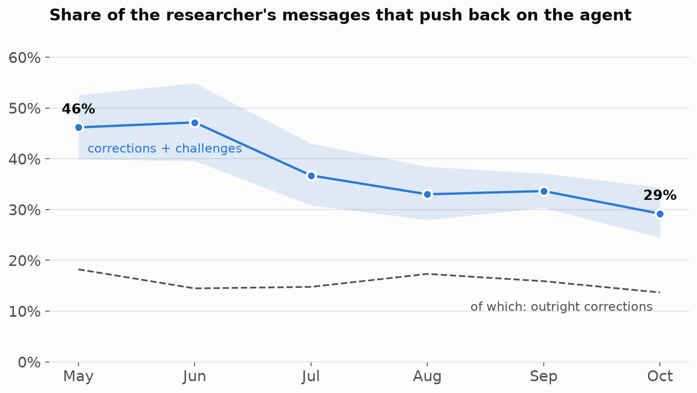
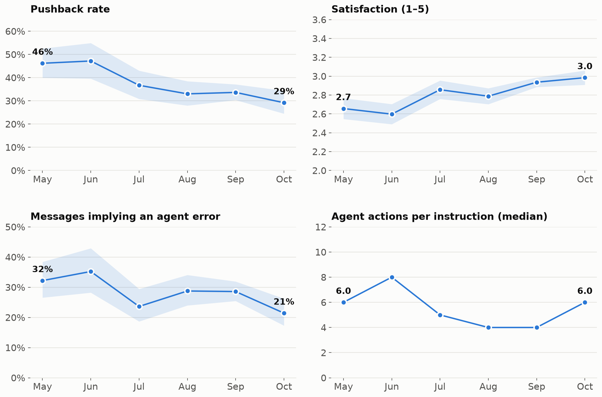
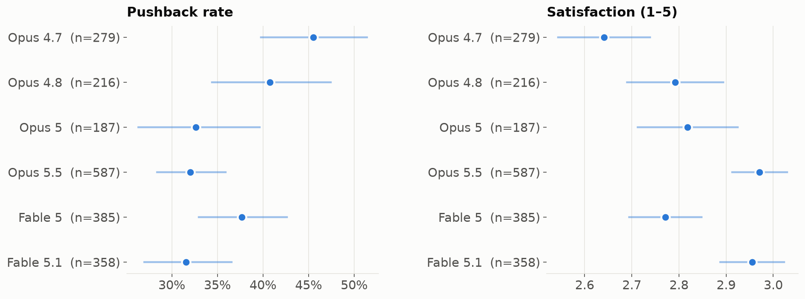

# Agent quality over time

How did working with coding agents change over six months? We didn't run a benchmark. We measured the researcher's **own messages to the agent**: about 2,000 of them, from April to October 2026, across six Claude models. A small model (Haiku) labelled each message as a *correction* ("that's wrong, undo it"), a *challenge* ("are you sure? why not just…?"), *praise*, an *instruction* or *other*. It also gave each one a 1–5 satisfaction score and flagged whether the message implied the agent had made a mistake.

**Pushback** means corrections plus challenges: how often the researcher had to steer against what the agent had just done.

- **Pushback fell from 46% to 29%.** Almost all of the fall is in **challenges**. The researcher asked "are you sure?" about half as often by October.
- **Outright corrections stayed flat at about 15%.** Roughly one message in seven still says "that's wrong".

## Four measures, month by month

- **Satisfaction** rose from about 2.7 to 3.0 out of 5. That's from slightly unhappy to neutral; it isn't delight.
- **Messages implying an agent error** fell from about a third to about a fifth.
- **Agent actions per instruction** stayed flat: the agent does about 4–8 things per message. More of the work moved into background jobs and shorter, more numerous threads, which these numbers don't capture.

## By model

!!! warning "This is not a model ranking"
    Each model was used in different months, on different projects, by a researcher who was getting better at working with agents. The ordering mostly follows the calendar. Read this as how *working practice* changed, not as a controlled comparison.

## The numbers

| Month | Messages | Pushback | Corrections | Challenges | Agent error | Satisfaction | Actions / instruction |
|---|---|---|---|---|---|---|---|
| 2026-04 † | 6 | 67% | 17% | 50% | 17% | 2.50 | 6 |
| 2026-05 | 236 | 46% | 18% | 28% | 32% | 2.66 | 6 |
| 2026-06 | 159 | 47% | 14% | 33% | 35% | 2.60 | 8 |
| 2026-07 | 237 | 37% | 15% | 22% | 24% | 2.86 | 5 |
| 2026-08 | 306 | 33% | 17% | 16% | 29% | 2.79 | 4 |
| 2026-09 | 749 | 34% | 16% | 18% | 29% | 2.94 | 4 |
| 2026-10 | 322 | 29% | 14% | 16% | 21% | 2.98 | 6 |

† fewer than 30 messages; not plotted.

| Model | Messages | Pushback | Agent error | Satisfaction |
|---|---|---|---|---|
| Opus 4.7 | 279 | 46% | 31% | 2.64 |
| Opus 4.8 | 216 | 41% | 29% | 2.79 |
| Opus 5 | 187 | 33% | 27% | 2.82 |
| Opus 5.5 | 587 | 32% | 26% | 2.97 |
| Fable 5 | 385 | 38% | 30% | 2.77 |
| Fable 5.1 | 358 | 32% | 26% | 2.96 |

Bands and whiskers are 95% intervals (Wilson for rates). Satisfaction is a 1–5 scale where 3 is neutral.

## How much to trust the labels

The labeller is a cheap model, so we checked it. A larger model (Sonnet) independently labelled 150 messages:

| Agreement | Value |
|---|---|
| Message type (correction / challenge / …), κ | 0.65 |
| Pushback yes/no | 89% |
| Satisfaction, Spearman ρ | 0.74 (mean difference 0.25) |
| Agent error yes/no | 88% |

That's good enough for trends across hundreds of messages, not for judging single messages. Praise is too rare to measure reliably.

An earlier attempt used **keyword matching** ("no", "wrong", "thanks"…). It missed about 80% of corrections, because this researcher mostly corrects by asking questions. See [methodology](../methodology.md) for the full pipeline and its limits.

[Back to the deck ↩](../../?scene=quality)
