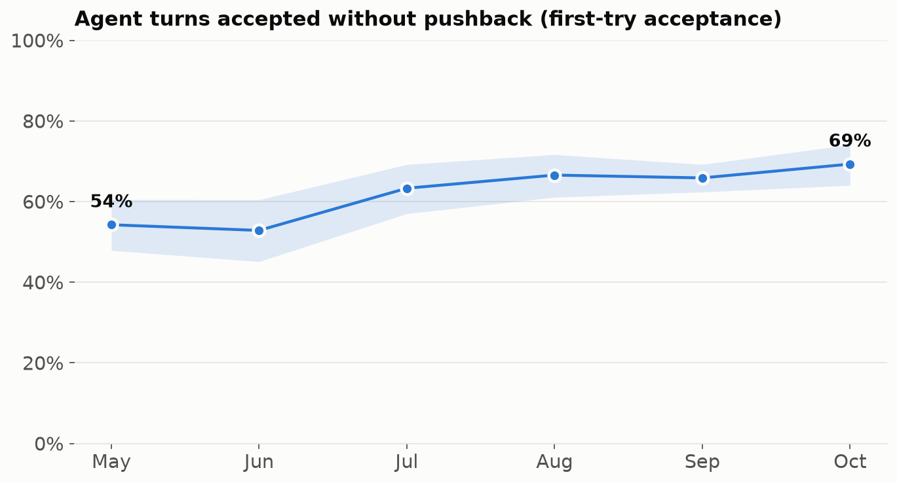
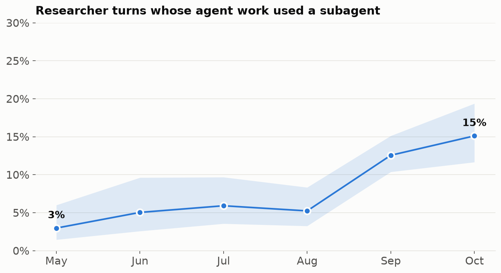
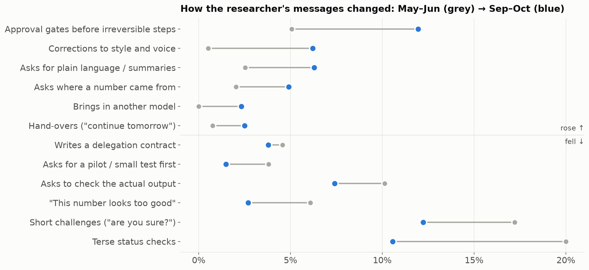

# What changed in six months? A preregistered look

[Agent quality over time](quality-over-time.md) showed that pushback fell. Here we ask *what else* changed in how the researcher works with agents, as scientists would. **The hypotheses and the analysis plan were written down and committed before any of these measures were computed.** Then they were tested, and the surprising results were checked before being believed.

**Data:** about 2,000 of the researcher's messages to Claude Code on an HPC cluster, May–October 2026 (April has too few to test), plus a second machine (September–October only) as a replication, plus git history.

**Methods:**
- Deterministic measures straight from the transcripts: tool calls, subagent use, tests and builds run, edits to instruction files, git activity.
- A cheap model (Haiku) labelling each message, checked against a larger model (Sonnet) on 150 messages per task.
- Early (May–June) vs late (September–October) comparisons, with a trend test and a multiple-comparison correction.

## Scorecard

| # | Hypothesis (as preregistered) | Result | Verdict |
|---|---|---|---|
| H1 | "Are you sure?" challenges fall; outright corrections don't change | Challenges 30% → 17% (p ≈ 10⁻⁷); corrections 17% → 15% | **Supported** |
| H2 | Delegation rises on at least 3 of 4 channels | Subagent use more than tripled (p ≈ 10⁻⁷); Codex hand-offs barely; background jobs *fell*; cross-session dispatch absent on this machine | **Not supported** as written (one strong channel) |
| H3 | More "done" claims come with evidence | The automatic proxy fell, 28% → 15%, but that shrinks to n.s. once checks done inside subagents are allowed for. A manual audit of 60 claims found real evidence in 67% (early) vs 50% (late), n.s. | **Inconclusive.** The robust part is the level: **about half of "done" claims come with evidence** |
| H4 | Errors fixed by a hook or guard recur less than errors fixed by a memory note | Zero genuine hook edits in the data. Memory notes: same-thread recurrence 37%, the same as the random baseline (37%). Test and guard edits are followed by *more* local recurrence (59%), most likely because tests get written where errors cluster | **Not testable.** No sign that memory notes reduce recurrence |
| H5 | Responses to errors shift from re-explaining to structural fixes | Structural responses flat at about 60–67%; re-explaining flat at about 26% | **Not supported** |
| H6 | More output | Commits roughly doubled (Jan–Feb about 120 a month → Sep 221). The share co-authored by Claude went from about 2% to 70–90%. Turns with git activity: 11% → 31% | **Supported** on a weak proxy |
| H7 | More agent turns accepted first time | 54% → 69% (p ≈ 10⁻⁶); rework chains shorter | **Supported** |

## How the researcher's own behaviour changed (exploratory)

Each message was tagged against a codebook of about 30 behaviours from the [pattern catalogue](../patterns/catalogue.md). Six codes that the two models disagreed on (κ < 0.4) were dropped. *This is hypothesis-generating, not tested.*

**Reading:**
- **Less policing.** Fewer status checks, fewer "are you sure?" challenges, less "this number looks too good", less "show me the output".
- **More governing.** More approval gates before irreversible steps, more provenance questions, more hand-overs, more cross-model work.
- **And more editing.** Corrections to *style and voice*, and requests for plain language, rose sharply.

## The kind of error changed

Among messages implying an agent mistake (labelling agreement is only borderline here, κ ≈ 0.49, so treat this as indicative):

| Error type | May–Jun | Sep–Oct |
|---|---|---|
| Didn't run or verify | 27% | 16% |
| Claimed done falsely | 15% | 10% |
| Misunderstood what was wanted | 14% | **23%** |
| Style or verbosity | 5% | **19%** |
| Ignored an instruction | 8% | 8% |
| Physics or maths error | 2% | 2% |

**Execution errors fell; errors of intent and taste rose.** Six months in, the bottleneck is less "did it do the work correctly?" and more "did it understand what I wanted, and say it the way I want?"

## What we learned about doing this

- **Two of the first-pass "reversals" were measurement artefacts.** One test was saturated: almost every error type recurs within 14 days anyway. The other had a blind spot: checks done inside subagents were invisible. Both were caught by applying [a surprising number is a bug first](../patterns/surprising-number.md) to our own results.
- **Preregistering made the failures visible.** Without it, H2, H4 and H5 would have quietly disappeared from the story.
- **Confounds:** model, month, project and the researcher's own skill all move together. This is a study of one person's *working practice*, not of models.

See [methodology](../methodology.md) for the label validation and pipeline.

[Back to the deck ↩](../../?scene=what-changed)
